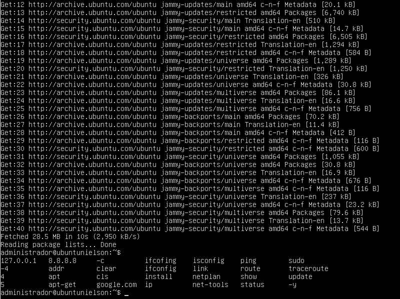

## 6. Tarefas de Pós-Instalação
Após o reinício completo da máquina virtual:

1. Realize o login no console tty1 com as credenciais criadas:
   * **Login:** `administrador`
   * **Senha:** `adminifal`
2. Execute o comando de atualização da lista de pacotes para garantir a comunicação correta com os espelhos oficiais:
   ```bash
   sudo apt-get update
   ```
3. Digite a senha `adminifal` quando solicitado pelo `sudo`.
4. Instale o **VirtualBox Extension Pack** no computador hospedeiro (se ainda não o tiver) acessando o site oficial: [virtualbox.org/wiki/Downloads](https://www.virtualbox.org/wiki/Downloads).


## RESOLUÇÃO 

1. Login no console<br>
```bash
ubuntu_server login: administrador
Password: adminifal
```


2. Atualizar a lista de pacotes<br>
``` bash
sudo apt-get update
```
> rodou tranquilamente sem erros


3. Informar a senha do usuário quando o `sudo` pedir.
> digitei a senha e a senha nao apareceu, comportamento normal do linux.