## 5. Exercício Prático de Fixação

Para consolidar as competências adquiridas, cada aluno ou grupo deverá executar de forma autônoma a seguinte tarefa:

1. **Criar um novo grupo** chamado `financeiro`.
2. **Associar os usuários** `cicrano` e `beltrano` ao grupo `financeiro` (além do grupo `devs` ao qual já pertencem).
3. **Criar uma nova pasta** compartilhada em `/srv/financeiro`.
4. **Definir as seguintes permissões de acesso:**
   * O usuário `administrador` deve ter controle total.
   * O grupo `financeiro` deve ter acesso de leitura e escrita.
   * Os membros do grupo `devs` (como `fulano`) e o usuário `novato` **não** devem ter acesso a esta pasta financeira.
5. **Demonstrar em testes de terminal** que `cicrano` consegue criar e alterar um relatório na pasta, enquanto `fulano` e `novato` recebem a mensagem `Permission denied`.


## RESOLUÇÃO

## RESOLUÇÃO

1. Criar os usuários<br>
```bash
sudo adduser fulano
sudo adduser cicrano
sudo adduser beltrano
sudo adduser novato
```
> usei a senha `senha123` para os quatro usuários
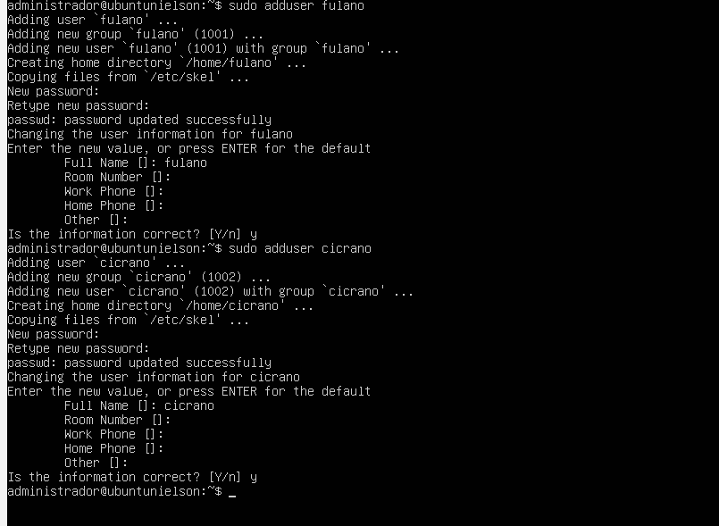

2. Verificar os usuários no `/etc/passwd`<br>
```bash
tail -n 4 /etc/passwd
```
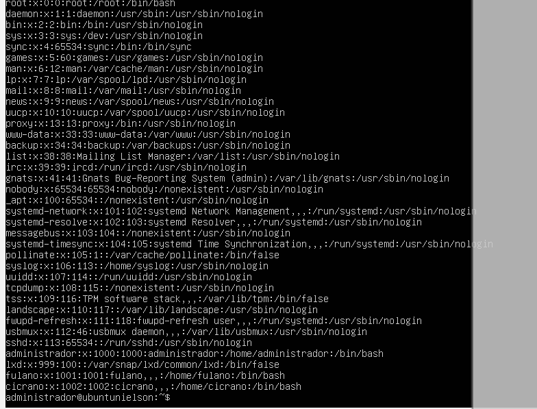

3. Criar o grupo `devs` e adicionar os usuários<br>
```bash
sudo groupadd devs
sudo usermod -aG devs fulano
sudo usermod -aG devs cicrano
sudo usermod -aG devs beltrano
```
> o `novato` não entra no grupo

4. Validar o grupo<br>
```bash
grep "devs" /etc/group
```


5. Criar o diretório compartilhado<br>
```bash
sudo mkdir -p /srv/projeto
ls -ld /srv/projeto
```
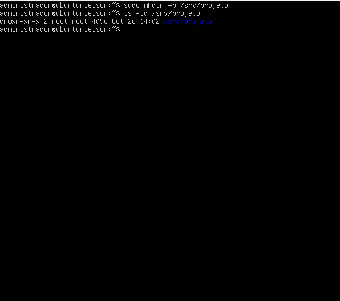

6. Mudar dono e grupo<br>
```bash
sudo chown administrador /srv/projeto
sudo chgrp devs /srv/projeto
ls -ld /srv/projeto
```
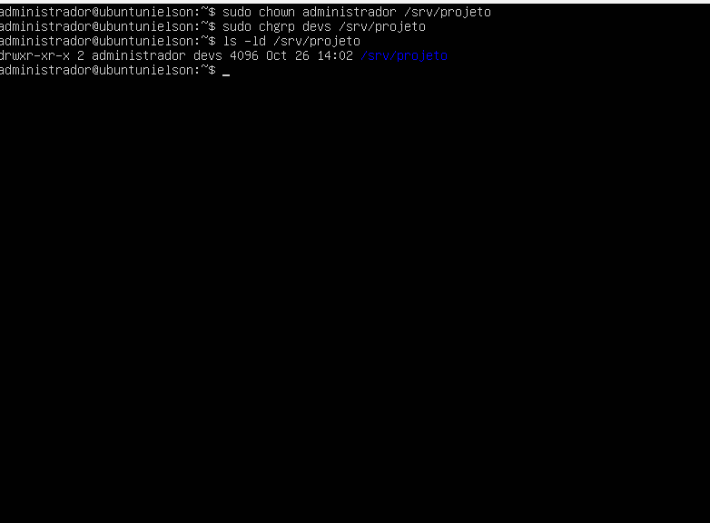

7. Aplicar permissão 770<br>
```bash
sudo chmod 770 /srv/projeto
ls -ld /srv/projeto
```
> ficou `drwxrwx---`, só dono e grupo acessam
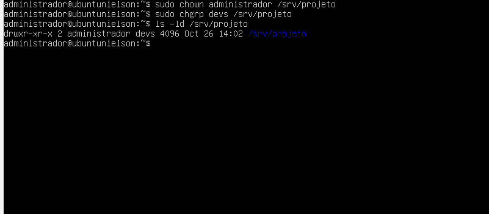

8. Criar o arquivo de teste<br>
```bash
echo "Especificacao tecnica do roteador de borda" > /srv/projeto/config_redes.txt
chmod 660 /srv/projeto/config_redes.txt
ls -l /srv/projeto/config_redes.txt
```


9. Teste A: usuário do grupo (`fulano`)<br>
```bash
su - fulano
cd /srv/projeto
ls -l
echo "Revisado por Fulano" >> config_redes.txt
cat config_redes.txt
exit
```
> o fulano conseguiu entrar, ler e escrever, pois pertence ao grupo `devs`
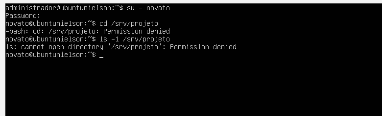

10. Teste B: usuário externo (`novato`)<br>
```bash
su - novato
cd /srv/projeto
ls -l /srv/projeto
exit
```
> o novato recebeu `Permission denied`, pois não pertence ao grupo `devs`


## Exercício de Fixação

1. Criar o grupo `financeiro` e adicionar `cicrano` e `beltrano`<br>
```bash
sudo groupadd financeiro
sudo usermod -aG financeiro cicrano
sudo usermod -aG financeiro beltrano
grep "financeiro" /etc/group
```
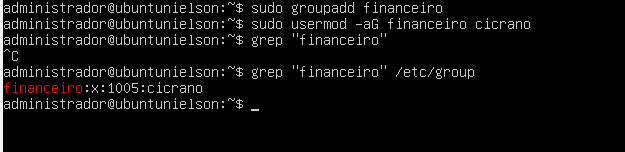

2. Criar a pasta `/srv/financeiro` e definir permissões<br>
```bash
sudo mkdir -p /srv/financeiro
sudo chown administrador /srv/financeiro
sudo chgrp financeiro /srv/financeiro
sudo chmod 770 /srv/financeiro
ls -ld /srv/financeiro
```
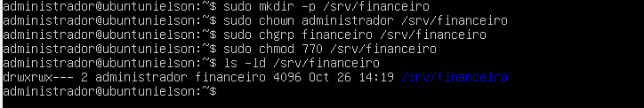

3. Teste com `cicrano` (grupo financeiro)<br>
```bash
su - cicrano
cd /srv/financeiro
echo "Relatorio financeiro Q1" > relatorio.txt
echo "Atualizado por Cicrano" >> relatorio.txt
cat relatorio.txt
exit
```
> o cicrano conseguiu criar e alterar o relatório
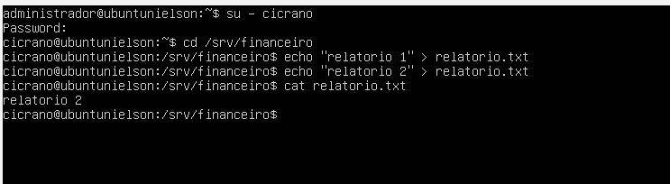

4. Teste com `fulano` (apenas devs)<br>
```bash
su - fulano
cd /srv/financeiro
exit
```
> `Permission denied`
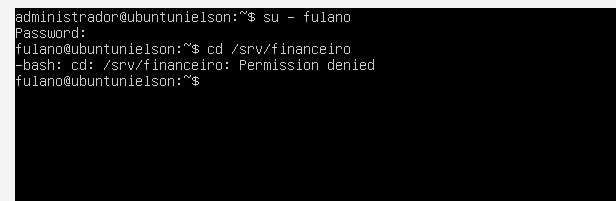

5. Teste com `novato` (externo)<br>
```bash
su - novato
cd /srv/financeiro
exit
```
> `Permission denied`
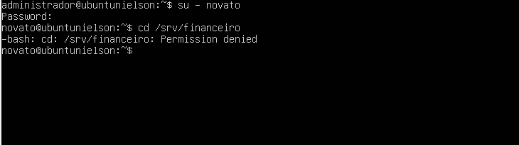