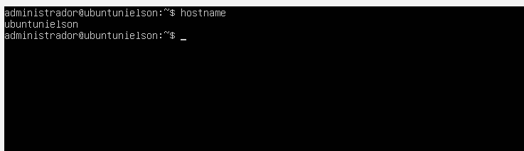
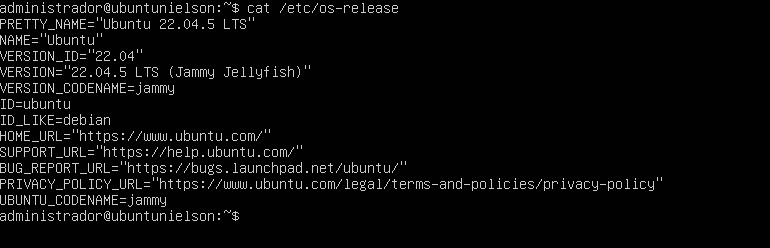
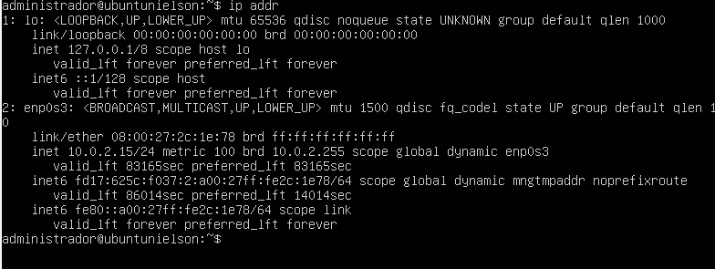
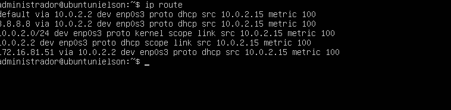
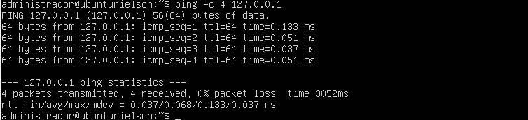
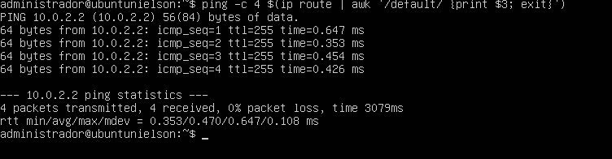
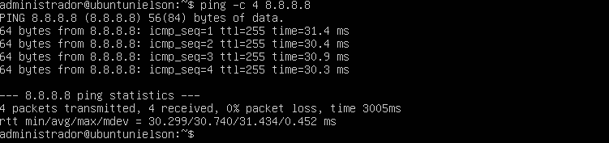
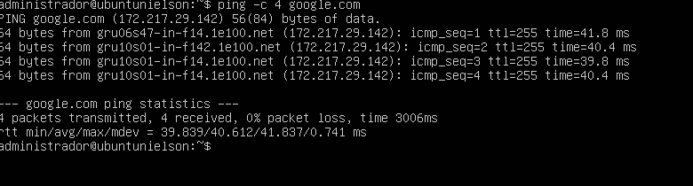
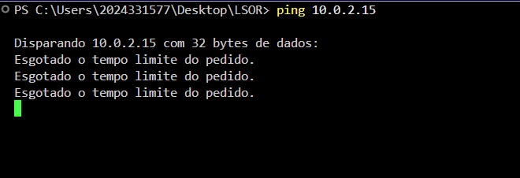

## 1. Identificação

- **Nome:** José Nielson Silva Barbosa
- **Matrícula:** 2024331577
- **Turma:** 913A
- **Data:** 26/10/2026
- **Título:** Análise de conectividade de rede em máquinas virtuais - NAT x Bridge

## 2. Objetivo

Analisar a configuração de rede de uma máquina virtual Linux, identificar o endereço IP, a máscara de rede, o gateway e o endereço MAC, realizar testes de conectividade utilizando o comando `ping` e comparar os modos de rede NAT e Bridge na VirtualBox.

## 3. Ambiente

- **Sistema hospedeiro:** Windows 11.
- **Virtualizador:** Oracle VirtualBox.
- **Sistema operacional convidado:** Ubuntu Server.
- **Memória RAM:** [preencher com a quantidade configurada].
- **Interface de rede:** `enp0s3`.
- **Modo de rede inicial:** NAT.
- **Modo de rede para comparação:** Bridge.

## 4. Procedimento

### 4.1. Identificação do sistema

Comandos executados:

```bash
hostname
cat /etc/os-release
```

Esses comandos identificam o nome da máquina e a distribuição Linux utilizada.

### 4.2. Identificação da interface de rede

Comando executado:

```bash
ip addr
```

O comando permite identificar as interfaces de rede, os endereços IP, os prefixos de rede e os endereços MAC.

### 4.3. Identificação da rota padrão

Comando executado:

```bash
ip route
```

O comando apresenta a tabela de rotas e permite identificar o gateway padrão.

### 4.4. Teste de loopback

Comando executado:

```bash
ping -c 4 127.0.0.1
```

Esse teste verifica a comunicação com a própria máquina.

### 4.5. Teste do gateway

Comando executado:

```bash
ping -c 4 $(ip route | awk '/default/ {print $3; exit}')
```

Esse teste verifica a comunicação entre a máquina virtual e o gateway padrão.

### 4.6. Teste de conectividade externa

Comando executado:

```bash
ping -c 4 8.8.8.8
```

Esse teste verifica a conectividade com um endereço IP externo.

### 4.7. Teste de resolução DNS

Comando executado:

```bash
ping -c 4 google.com
```

Esse teste verifica a resolução de nomes de domínio e a conectividade com o destino.

### 4.8. Teste de conectividade entre o host e a máquina virtual

No PowerShell do Windows, foi executado:

```powershell
ping 10.0.2.15
```

O resultado apresentou tempo limite esgotado nas tentativas, indicando que não houve resposta da máquina virtual nesse endereço.

No modo NAT padrão da VirtualBox, o host normalmente não consegue acessar diretamente o endereço IP privado da VM pela rede física.

### 4.9. Configuração do modo Bridge

Para realizar a comparação, é necessário desligar a máquina virtual, acessar as configurações de rede da VirtualBox e alterar o modo de conexão para **Placa em modo Bridge**.

Após iniciar a VM, executar novamente:

```bash
ip addr
ip route
```

Em seguida, repetir os testes de conectividade e registrar os endereços e resultados observados.

## 5. Testes e comparação

### 5.1. Comparação entre NAT e Bridge

| Característica | NAT | Bridge |
|---|---|---|
| Endereço IP | `10.0.2.15` | [preencher com o resultado] |
| Gateway | [preencher] | [preencher] |
| Host acessa a VM? | Não houve resposta ao ping para `10.0.2.15` | [preencher após o teste] |
| Acesso à Internet | [registrar o resultado do teste] | [registrar o resultado do teste] |

## Evidências dos testes

### 1. Identificação do sistema


### 2. Interfaces de rede — NAT


### 3. Rotas e gateway — NAT


### 4. Teste de loopback


### 5. Teste do gateway


### 6. Teste de conectividade externa


### 7. Teste de resolução DNS


### 8. Teste entre o Windows e a VM — NAT


### 9. Configuração e teste — Bridge



## 6. Problemas e soluções

Durante o teste de conectividade entre o Windows e a máquina virtual no modo NAT, o comando `ping 10.0.2.15` apresentou tempo limite esgotado.

Esse comportamento é compatível com o funcionamento do NAT padrão da VirtualBox, no qual a VM utiliza uma rede privada e não disponibiliza automaticamente o acesso direto do host ao seu endereço IP.

Para comparar o comportamento, deve-se testar o modo Bridge. Nesse modo, a VM geralmente recebe um endereço IP da rede local, permitindo a comunicação direta com o host, desde que a rede e as regras de firewall permitam.

## 7. Conclusão

A prática permite compreender como os modos NAT e Bridge influenciam a conectividade de uma máquina virtual. Os comandos `ip addr` e `ip route` permitem identificar as interfaces de rede, os endereços IP e o gateway padrão.

Os testes com `ping` permitem verificar a comunicação com a própria máquina, o gateway e destinos externos. A comparação entre NAT e Bridge demonstra diferenças no endereçamento e no acesso à máquina virtual.

Os resultados finais devem ser preenchidos com base nos testes efetivamente realizados e nas capturas de tela obtidas durante a atividade.